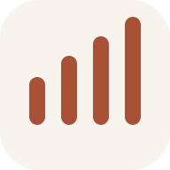
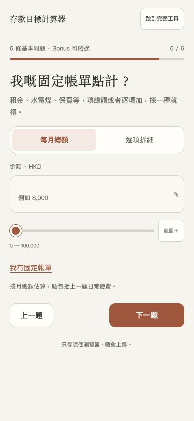
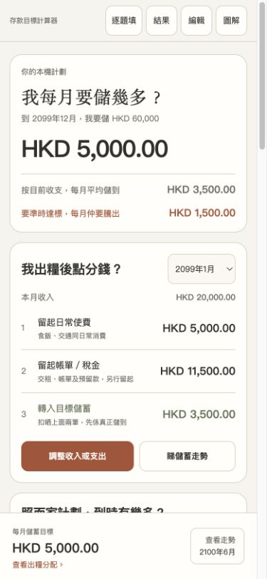

<div align="center">
  
  <h1>存款目標計算器</h1>
  <p><strong>Know what to save each month. Leave with a payday plan.</strong></p>
  <p>A small savings planner that keeps your numbers in your browser.</p>
  <p><a href="https://savings-goal-calculator-9eo.pages.dev/#start"><strong>Try the planner</strong></a> · <a href="https://savings-goal-calculator-9eo.pages.dev/offline.zip">Download offline</a> · <a href="README.zh-HK.md">廣東話</a></p>
  <p>No signup · No financial-data uploads · MIT licensed</p>
</div>

**“How much should I save each month?”** Set a target, add your income and spending,
and see the monthly saving you need, what your budget allows, and the gap. A payday
plan shows what to keep for spending and bills, and what can actually go into savings.

The interface is in **Traditional Chinese / Cantonese**, designed for phones.
Hong Kong bill categories are built in; six display currencies are supported.

<p align="center">
  
  
</p>

*Real product screens. All amounts are invented; the projection uses 2099 dates.*

## Start with a question, leave with a plan

1. **Pick a goal and a timeframe.** Add what you've already saved, monthly income
   and everyday spending.
2. **Choose how to enter bills.** One monthly total, or a detailed breakdown.
   Add rent, utilities and insurance only if you want the detail.
3. **Add a Bonus or skip it.** See the result immediately, then adjust the plan.

Prefer one page? **Jump to the full tool** at any time.

## Make the tradeoffs visible

| What you want to know | What the planner shows |
| --- | --- |
| How much do I need to save each month? | The total monthly target, current average and remaining gap, upfront. |
| How do I split my pay? | A month-by-month allocation for spending, bills/tax and actual net saving. |
| Will I make my deadline? | Projected balance, shortfall and progress toward the goal. |
| When will I actually get there? | A savings line that continues to the estimated goal date, up to ten years. |
| What if I spend less or earn more? | Sliders update the result and monthly cash flow immediately. |
| What about a Bonus or irregular bills? | Dated one-off income and utility payments in their selected months. |
| Can I show someone my plan? | A share link they can open and adjust without replacing their saved plan. |

## Your numbers stay with you

- **Local by default.** Inputs and unfinished answers stay in this browser's
  localStorage. No account, finance backend, analytics or third-party scripts.
- **Offline after the first load.** Once the app reports that offline use is
  ready, it can reopen without a connection. Or download the self-contained HTML.
- **Sharing is a choice.** A link contains the plan in its URL fragment. Anyone
  with that link can read its amounts and labels; it is **not encrypted**.

The hosted site still makes normal requests to Cloudflare for app files.
Financial inputs are not sent with those requests. Clearing site data removes
local settings. See [privacy and sharing](PRIVACY.md) for the practical limits.

## What the estimate includes

This is a **cash-flow simulation**. It uses integer-cent arithmetic and your
entered figures, with no investment returns, inflation or automatic tax estimate.
Utilities use their selected payment schedule. Rates and annual insurance use
monthly reserves. Currency selection changes the display; it does not convert
amounts. [How the calculation works](docs/calculation.md).

## Run it yourself

For everyday use, [open the hosted app](https://savings-goal-calculator-9eo.pages.dev/)
or [download the offline version](https://savings-goal-calculator-9eo.pages.dev/offline.zip).
No installation is required.

For contributors: Node.js 22+ and Python 3.10+.

```sh
git clone https://github.com/tombelieber/savings-goal-calculator.git
cd savings-goal-calculator
npm ci
npm run build
npm test
python3 -m http.server 8080 --bind 127.0.0.1 --directory dist
```

Open **http://127.0.0.1:8080**. Only `dist/` is served; development dependencies
are not shipped. [Deploy your own copy to Cloudflare Pages](docs/deployment.md).

## Help make saving easier to understand

UI clarity, accessibility, translations and reproducible calculation bugs are
welcome. Start with [CONTRIBUTING.md](CONTRIBUTING.md). Use **invented data** in
issues, screenshots and pull requests. For security concerns, follow
[SECURITY.md](SECURITY.md).

Built by [Tom Tang](https://github.com/tombelieber). Licensed under [MIT](LICENSE).
